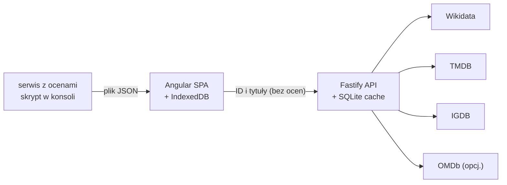

<div align="center">

<!-- Logo: docs/brand/logo.svg (do przygotowania w fazie 6) -->


# Kinoskop

**Twoje kino w liczbach.** Statystyki, mapa gustu i nagrody filmowe na podstawie Twoich ocen filmów, seriali i gier.

[](https://github.com/OWNER/kinoskop/actions)
[](LICENSE)
-221F17?style=flat-square)

<br/>

<a href="https://skillicons.dev">
  
</a>

<br/><br/>


**Dane:**


**AI (Twój klucz):**


</div>

---

## ✨ Co potrafi

| | |
|---|---|
| 🎞️ **Podstawowe statystyki** | liczba tytułów wg gatunku, top gatunek, rozkład ocen, osobno dla filmów, seriali i gier |
| 🔎 **Złożone filtrowanie** | łącz dowolnie: gatunek, kraj, narodowość reżysera, epokę akcji, twórców, nagrody, zakres ocen i lat |
| 🌍 **Świat i twórcy** | mapa krajów produkcji, narodowości reżyserów, rankingi reżyserów i aktorów |
| 🏛️ **Epoki historyczne** | w jakich czasach dzieją się filmy, które oglądasz i które oceniasz najwyżej |
| 🏆 **Nagrody na osi czasu** | Oscary, Cannes, Berlinale, Wenecja, BAFTA, Złote Globy, Orły, Gdynia, Emmy, The Game Awards… |
| 🎯 **Zgodność nagród z gustem** | które nagrody najlepiej przewidują, co Ci się spodoba, plus rekomendacje z informacją, gdzie obejrzeć w Polsce |
| 🧭 **Twój gust** | co podnosi i obniża Twoje oceny, sprawdzone duety reżyser × aktor, współpracownicy twórców |
| 🔒 **Prywatnie** | bez kont; Twoje oceny zostają w przeglądarce i znikają po jej zamknięciu |

<!-- Zrzuty ekranu: docs/screenshots/*.png (faza 7) -->
<p align="center">
  
  
</p>

## 🚀 Jak zacząć (dla użytkownika)

Są dwie drogi importu. Obie działają w całości w przeglądarce.

### A. Skrypt Kinoskopu (zalecane, najdokładniejsze dane)

1. Zaloguj się na **filmweb.pl**, a potem otwórz w tej karcie `https://www.filmweb.pl/robots.txt` (prosta strona, która nie przeładuje się w trakcie importu).
2. W Kinoskopie kliknij **„Skopiuj skrypt”**.
3. Na tej karcie otwórz konsolę (`Ctrl+Shift+J` / `Cmd+Option+J`, w Firefoksie `Ctrl+Shift+K`), wpisz `allow pasting`, jeśli przeglądarka o to poprosi, wklej skrypt i naciśnij Enter.
4. Przeciągnij pobrany plik `kinoskop-eksport-….json` na stronę Kinoskopu.

Przy dużym profilu skrypt zapisuje dwa pliki. **Część 1** powstaje po kilku minutach: wczytaj ją od razu, statystyki będą gotowe. Potem skrypt pobiera tytuł i rok pozycji, których Wikidata nie zna po identyfikatorze (u autora ok. 2300 tytułów, ok. pół godziny), i zapisuje **część 2**. Przeciągnięta do Kinoskopu uzupełnia część 1 bez utraty dopasowań. Pobrane tytuły skrypt pamięta w przeglądarce (`localStorage` na filmweb.pl), więc kolejne importy trwają kilka minut. Trzymaj kartę na wierzchu (może być w osobnym oknie), bo karty w tle przeglądarka spowalnia. Przerwany import wznawia się po ponownym uruchomieniu.

Skrypt pobiera tylko **Twoje własne dane** (oceny, daty, listy) zapytaniami GET, w tempie zbliżonym do ręcznego przeglądania, i zapisuje plik na Twoim dysku. Regulamin serwisu ogranicza korzystanie z programów automatycznych, więc z importu korzystasz na własną odpowiedzialność. Jego pełny kod jest widoczny w aplikacji przed skopiowaniem. Szczegółowa instrukcja z rozwiązywaniem problemów jest w aplikacji.

### B. Masz już plik CSV z innego narzędzia

Przeciągnij na stronę importu jeden lub kilka plików CSV w formacie Letterboxd, np. z konwerterów ocen do tego formatu
(`Title,Year,WatchedDate,Rating10`) albo eksport z samego Letterboxd (`Name,Year,Rating`). Rodzaj (film, serial,
gra) i listę („chcę zobaczyć”) Kinoskop rozpozna po nazwie pliku, a przed zapisem pokaże podsumowanie.
Takie pliki nie mają identyfikatorów tytułów ani ulubionych, więc tytuły są dopasowywane po nazwie i roku.
Wymaga to klucza `TMDB_API_TOKEN` (dla gier `TWITCH_*`), a część pozycji może trzeba będzie potwierdzić
w widoku **Weryfikacja**. Szczegóły: SPEC §5.4.

Wyjątek to tabele archiwum z Filmweb2Letterboxd: `Filmweb2Letterboxd_wstepny_….csv` (bez tytułów, powstaje po
kilku minutach) i `Filmweb2Letterboxd_pelny_….csv` (z tytułami). Mają identyfikatory Filmwebu, ulubione i gry, więc
Kinoskop dopasowuje je tak jak plik ze skryptu. Plik wstępny możesz wczytać od razu (dopasujemy tytuły znane
Wikidata), a pełny później, bo uzupełni dane bez utraty dopasowań. Możesz przeciągnąć cały folder pobranych plików:
raport błędów, surowe archiwum JSON i pliki Letterboxd tego narzędzia zostaną pominięte.

### C. Masz kopię swoich danych z serwisu z ocenami

Jeśli poprosisz serwis o kopię swoich danych (RODO art. 15), możesz dostać pliki JSON z listą `votes`, np.
`…_films.json`, `…_serials.json` i `…_episodes.json`. Przeciągnij je razem na stronę importu: Kinoskop pokaże
podgląd jak dla CSV i dopasuje tytuły po nazwie i roku. Te pliki mają tylko polski tytuł, rok i ocenę, więc
statystyki są skromniejsze: bez dat ocen nie ma wykresów w czasie, nie ma też ulubionych ani listy „chcę zobaczyć”.
Oceny odcinków i komentarze są pomijane. Szczegóły: SPEC §5.4.

Chcesz tylko zobaczyć, co potrafi aplikacja? Kliknij **„Zobacz demo”**. To fikcyjny profil.

## 🛠️ Uruchomienie lokalne (dla dewelopera)

**Wymagania:** Node.js 24 LTS, pnpm 9+.

```bash
git clone https://github.com/OWNER/kinoskop.git
cd kinoskop
pnpm install
cp .env.example .env        # uzupełnij klucze (patrz niżej)

pnpm dev                    # backend (:3000) i frontend (:4200) jednocześnie
# albo osobno:
pnpm nx serve api           # backend → http://localhost:3000
pnpm nx serve web           # frontend → http://localhost:4200 (proxy /api → 3000)
```

| Polecenie | Co robi |
|---|---|
| `pnpm nx test <projekt>` | testy jednostkowe (Vitest) |
| `pnpm nx e2e web-e2e` | testy e2e (Playwright) na przykładowym eksporcie z `fixtures/` |
| `pnpm nx build import-script` | buduje skrypt konsolowy i bookmarklet |
| `pnpm awards:refresh` | odświeża katalog nagród z Wikidata (`apps/api/src/assets/awards.json`) |
| `pnpm demo:generate` | regeneruje fikcyjny profil demo z Wikidata (deterministyczny seed) |
| `docker compose up --build` | lokalnie: API w kontenerze + front |

Bez kluczy TMDB/IGDB API działa w trybie „tylko Wikidata” (mapowanie, kraje, reżyserzy, epoki, nagrody),
a tryb demo nie potrzebuje API w ogóle. Stan wstępnej wersji, odstępstwa od SPEC i rzeczy czekające na
autora: [`docs/open-questions.md`](docs/open-questions.md).

### Zmienne środowiskowe

| Zmienna | Wymagana | Skąd wziąć |
|---|---|---|
| `TMDB_API_TOKEN` | ✅ | [themoviedb.org → Settings → API](https://www.themoviedb.org/settings/api) (API Read Access Token) |
| `WIKIDATA_CONTACT` | ✅ | Twój e-mail lub URL (trafia do nagłówka User-Agent) |
| `TWITCH_CLIENT_ID`, `TWITCH_CLIENT_SECRET` | dla gier | [dev.twitch.tv/console](https://dev.twitch.tv/console) (wymaga 2FA) |
| `OMDB_API_KEY` | ➖ | [omdbapi.com](https://www.omdbapi.com/apikey.aspx) |
| `WEB_ORIGIN` | ✅ | adres frontu (CORS); lokalnie `http://localhost:4200` |

## 🧭 Architektura



```
apps/web           Angular 22: widoki, wykresy, mapa gustu
apps/api           Fastify 5: wzbogacanie, nagrody, wyszukiwanie
libs/shared        schematy Zod i typy wspólne dla wszystkich części
libs/stats         czyste funkcje statystyk i filtrów
libs/import-script skrypt importu (konsola przeglądarki)
```

Pełna specyfikacja: [`SPEC.md`](SPEC.md).

> 🤖 **Epoki przez AI** działają na kluczu użytkownika (Anthropic, OpenRouter z darmowymi modelami albo Gemini). Klucz podaje się w aplikacji, zostaje w przeglądarce i nie trafia na serwer Kinoskopu, więc po stronie serwera nie ma żadnego klucza LLM.

## ☁️ Deploy (Render)

Repo zawiera Blueprint [`render.yaml`](render.yaml): API (`kinoskop-api`, Docker, plan free, Frankfurt) i front
(`kinoskop`, Static Site). Nic nie wdraża się samo – tworzysz to w swoim koncie Render:

1. Render Dashboard → **New → Blueprint** → wskaż to repozytorium.
2. Render zapyta o wartości `sync: false`:
   - `TMDB_API_TOKEN` – Twój token TMDB (klucz operatora, wspólny dla wszystkich użytkowników),
   - `WIKIDATA_CONTACT` – e-mail lub URL do nagłówka User-Agent,
   - `WEB_ORIGIN` – adres frontu, np. `https://kinoskop.onrender.com`,
   - `KS_API_BASE_URL` – adres API, np. `https://kinoskop-api.onrender.com`,
   - opcjonalnie `TWITCH_CLIENT_ID`, `TWITCH_CLIENT_SECRET`, `OMDB_API_KEY` (puste = wyłączone).
3. Dokładne adresy zobaczysz dopiero po utworzeniu usług. Jeśli różnią się od wpisanych, popraw `WEB_ORIGIN`
   (API) i `KS_API_BASE_URL` (front) w zakładce *Environment* i zrób ponowny deploy frontu – adres API jest
   wstrzykiwany do builda (`tools/render/inject-api-url.mjs`, razem z CSP).

Darmowy plan: API usypia po 15 minutach bez ruchu (wybudzenie ok. minuty – aplikacja pokazuje „Rozgrzewam
projektor…”), a cache metadanych znika przy restarcie, więc pierwszy import po przerwie jest wolniejszy.
Limit TMDB (20 zapytań/s) jest wspólny dla wszystkich użytkowników instancji.

Import skryptem jest włączony także w tej wersji (decyzja autora, SPEC §12). Każdy, kto go używa, robi to na
własnym koncie i na własną odpowiedzialność wobec regulaminu serwisu – aplikacja pokazuje to ostrzeżenie przed
skopiowaniem skryptu.

## 🔒 Prywatność

- Brak kont, analityki i ciasteczek śledzących.
- Twoje oceny są przechowywane **wyłącznie w przeglądarce** (IndexedDB) i czyszczone po jej zamknięciu. Przycisk „Usuń moje dane” działa natychmiast.
- Serwer otrzymuje tylko identyfikatory i tytuły do wzbogacenia; przechowuje w cache wyłącznie publiczne metadane filmów.
- Klucz AI (jeśli go podasz) jest trzymany w pamięci karty i wysyłany wyłącznie do wybranego dostawcy.

## 🙏 Źródła danych i atrybucje

<!-- Oficjalne logo pobierz ze strony TMDB „About → Logos & Attribution” i zapisz jako docs/brand/tmdb-logo.svg -->
&nbsp; This product uses the TMDB API but is not endorsed or certified by TMDB.

- Dane o dostępności w serwisach streamingowych: **JustWatch** (przez TMDB).
- Dane o grach: **IGDB.com**.
- Nagrody, epoki i narodowości: **Wikidata** (CC0).
- Oceny krytyków: **OMDb API** (opcjonalnie).

> **Kinoskop jest niezależnym projektem i nie jest powiązany z Filmweb ani jego właścicielem.** Import korzysta z nieudokumentowanego interfejsu, którego serwis używa na własnej stronie; może on przestać działać bez ostrzeżenia.

## 📄 Licencja

[MIT](LICENSE)
