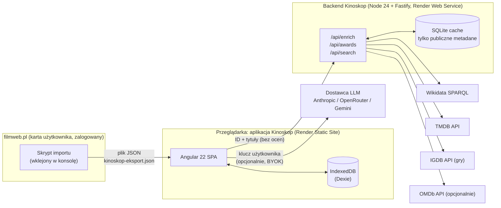

# Kinoskop — specyfikacja aplikacji

> Wersja: 1.1 · Data: 2026-11-18 · Odbiorca: Claude Code (implementacja) + autor projektu
> Nazwa: **Kinoskop** (zdefiniowana w jednym miejscu: `libs/shared/src/brand.ts`).
> Zmiany w 1.1: aplikacja publiczna; klasyfikacja epok przez LLM z kluczem użytkownika (BYOK); hosting na Render; plan na przyszłość (wersja płatna / darmowe modele).
> Zmiany w 1.3: **v1 działa wyłącznie lokalnie** (kod na GitHubie, bez publikacji). Deploy na Render i publiczny start przesunięte do osobnej, późniejszej fazy.
> Zmiany w 1.2: zgodność prawna (sekcja 14). Import publiczny ograniczony do danych własnych użytkownika (bez szczegółów tytułów z Filmwebu); tryb demo na danych przykładowych; minimalizacja danych wysyłanych do backendu.

## 1. Cel i zakres

Kinoskop to aplikacja webowa, która na podstawie **eksportu danych użytkownika z Filmwebu** (oceny filmów, seriali i gier oraz lista „chcę zobaczyć”) pokazuje:

1. **Statystyki znane z Filmwebu**: liczba tytułów wg gatunku, top gatunek, rozkład ocen, osobno dla filmów, seriali i gier.
2. **Statystyki, których Filmweb nie ma**, ze złożonym, łączonym filtrowaniem: kraje produkcji, **narodowość twórców**, epoki historyczne, w których dzieje się akcja, aktorzy, reżyserzy, Twoja ocena vs ocena ogółu (TMDB, IMDb) i krytyków.
3. **Nagrody filmowe, serialowe i growe na osi czasu** oraz ranking „które nagrody są najbardziej zbieżne z Twoim gustem” wraz z rekomendacjami.
4. **Mapę gustu**: interaktywny graf powiązań między gatunkami, twórcami i tytułami.

### 1.1 Zasady nadrzędne

- **Aplikacja publiczna**, dostępna dla każdego użytkownika Filmwebu, bez kosztów dla autora poza hostingiem.
- **Brak kont użytkowników.** Użytkownik importuje dane przy każdej nowej sesji przeglądarki.
- **Dane użytkownika zostają w przeglądarce.** Oceny nigdy nie są zapisywane na serwerze. Backend dostaje wyłącznie identyfikatory i tytuły do wzbogacenia, a zwraca publiczne metadane.
- **Klucze API użytkownika nigdy nie trafiają na serwer Kinoskopu.** Funkcje AI działają na kluczu użytkownika, wywoływane bezpośrednio z przeglądarki (sekcja 7.11).
- **Minimum pracy po stronie użytkownika.** Jedyny ręczny krok to wklejenie skryptu importu w konsolę na filmweb.pl, poprowadzone dobrą instrukcją (sekcja 5).
- **Nic na siłę.** Każda biblioteka musi uzasadnić swoją obecność.

### 1.2 Poza zakresem (non-goals)

- Konta, logowanie, synchronizacja między urządzeniami, trwałe przechowywanie danych użytkownika po stronie serwera.
- **Płeć twórców.** Aplikacja jej nie pobiera, nie przechowuje i nie pokazuje (świadoma decyzja produktowa).
- Rozszerzenia przeglądarki.
- Zapisywanie czegokolwiek w Filmwebie (skrypt robi wyłącznie zapytania GET).
- Pobieranie danych z Filmwebu przez backend (żadnego scrapingu po stronie serwera).
- Funkcje społecznościowe i porównywanie się z innymi użytkownikami.

---

## 2. Architektura



### 2.1 Monorepo (Nx + pnpm)

```
kinoskop/
├─ apps/
│  ├─ web/                 # Angular 22 SPA
│  └─ api/                 # Fastify 5 (TypeScript)
├─ libs/
│  ├─ shared/              # typy + schematy Zod (format eksportu, odpowiedzi API), brand.ts
│  ├─ import-script/       # źródło skryptu konsolowego → build esbuild do IIFE
│  └─ stats/               # czyste funkcje statystyk (bez Angulara), w 100% testowalne
├─ fixtures/               # przykładowe odpowiedzi Filmwebu i przykładowy eksport (zanonimizowany)
├─ docs/                   # zrzuty ekranu do instrukcji i README
├─ SPEC.md  README.md  CLAUDE.md
└─ docker-compose.yml
```

Uzasadnienie wyboru Nx: autor zna Nx komercyjnie, a współdzielone `libs/shared` (schematy Zod używane przez skrypt, frontend i backend) to dokładnie to, w czym monorepo pomaga.

### 2.2 Stos technologiczny

| Warstwa | Wybór | Po co |
|---|---|---|
| Frontend | **Angular 22** (standalone, zoneless, signals, nowy control flow, `@defer`) | aktualna stabilna wersja; przed startem sprawdź `ng version` i peer deps bibliotek |
| Style | **Tailwind CSS 4** + CSS custom properties (tokeny) | szybkie, spójne stylowanie, łatwy motyw |
| Prymitywy UI | **Angular CDK** (Overlay, A11y, ScrollingModule/virtual scroll, DragDrop dla strefy importu) | dostępność i virtual scroll bez ciężkiego frameworka UI |
| Wykresy | **Apache ECharts** przez **ngx-echarts**, import z `echarts/core` (tree-shaking) | słupki, histogramy, treemapa, mapa świata, heatmapa, oś czasu |
| Stan sesji | **Dexie.js** (IndexedDB) | dane mogą mieć kilka MB, więc sessionStorage się nie nadaje |
| Walidacja | **Zod** (współdzielone schematy) | walidacja pliku importu, odpowiedzi API i zewnętrznych źródeł |
| Ikony | **lucide-angular** | spójne, lekkie ikony |
| Fonty | **Fontsource** (self-hosted) | bez zapytań do Google Fonts (RODO) |
| Backend | **Node 24 LTS** + **Fastify 5** + `fastify-type-provider-zod` | lekki, szybki, typowany |
| Cache | **better-sqlite3** | prosty, plikowy cache metadanych |
| Limity zapytań | **bottleneck** (osobny limiter na każde zewnętrzne API) | szacunek dla limitów TMDB/IGDB/Wikidata |
| Logi | **pino** (bez body requestów) | prywatność |
| Testy | **Vitest** (unit), **Playwright** (e2e), **MSW** (mocki API we froncie) | |
| Build skryptu | **esbuild** → IIFE | jeden czytelny plik do wklejenia |
| CI | GitHub Actions: lint, test, build, e2e + cotygodniowe odświeżanie katalogu nagród | |
| Deploy | **Render** (Blueprint `render.yaml`): Static Site dla frontu + Web Service dla API; Dockerfile dla API (przenośność) | szczegóły w sekcji 8.4 |

---

## 3. Źródła danych

| Źródło | Klucz | Co bierzemy | Uwagi |
|---|---|---|---|
| **Filmweb** (wewnętrzne, nieudokumentowane API) | sesja użytkownika w jego przeglądarce | **wyłącznie dane własne użytkownika**: oceny, ulubione, daty ocen, „chcę zobaczyć”, a do dopasowania tytuł, tytuł oryginalny i rok | tylko przez skrypt w przeglądarce użytkownika; bez metadanych bazy Filmwebu (sekcja 14) |
| **Wikidata** (SPARQL, `query.wikidata.org`) | brak (nagłówek `User-Agent` z kontaktem) | mapowanie Filmweb ID → TMDB/IMDb/IGDB ID, nagrody i nominacje, epoka akcji, miejsce akcji, obywatelstwo twórców | CC0. Batchuj przez `VALUES`, max ~200 ID na zapytanie |
| **TMDB** | `TMDB_API_TOKEN` (v4 read token) | obsada, reżyserzy, kraje, słowa kluczowe, plakaty, **gdzie obejrzeć w PL** (dane JustWatch) | wymagana atrybucja TMDB i JustWatch |
| **IGDB** | `TWITCH_CLIENT_ID`, `TWITCH_CLIENT_SECRET` | gry: gatunki, platformy, studia, okładki | OAuth client credentials, limit 4 req/s; wymagana atrybucja |
| **OMDb** (opcjonalnie) | `OMDB_API_KEY` | ocena IMDb, Rotten Tomatoes, Metacritic | gdy brak klucza, funkcja „Ty vs krytycy” jest ukryta |
| **Dostawca LLM** (opcjonalnie, klucz użytkownika) | klucz podaje użytkownik w aplikacji | klasyfikacja epoki akcji dla tytułów bez danych w Wikidata/TMDB | wywołanie z przeglądarki, nigdy przez backend (sekcja 7.11) |

### 3.0 Licencje a model biznesowy

Obecna wersja jest **niekomercyjna** (bez reklam i opłat), a dopiero to pozwala korzystać z darmowych kluczy:
- TMDB API jest darmowe do celów niekomercyjnych, pod warunkiem atrybucji TMDB jako źródła danych i obrazów; użycie komercyjne wymaga licencji uzyskanej przez kontakt z TMDB.
- IGDB: komercyjne użycie wymaga partnerstwa i widocznej atrybucji.
- Każda wersja płatna (sekcja 13) wymaga najpierw uzyskania tych licencji. To decyzja biznesowa poza zakresem implementacji.

### 3.1 Właściwości Wikidata (zweryfikuj przed użyciem)

Claude Code **nie może zgadywać identyfikatorów**. Każde P-ID i Q-ID trzeba potwierdzić zapytaniem do Wikidata albo stroną właściwości, a zweryfikowane wartości trzymać w `apps/api/src/wikidata/ids.ts` z komentarzem, skąd pochodzą.

| Cel | Właściwość (oczekiwana) |
|---|---|
| Filmweb ID filmu/serialu | P5032 (Filmweb.pl film ID; obejmuje też seriale) |
| Filmweb ID osoby | sprawdź (prawdopodobnie P5033) |
| TMDB movie / TV / person ID | P4947 / P4983 / P4985 |
| IMDb ID | P345 |
| IGDB game ID | sprawdź |
| reżyser | P57 |
| obsada | P161 |
| kraj pochodzenia | P495 |
| obywatelstwo (narodowość twórcy) | P27 |
| epoka akcji („set in period”) | P2408 |
| miejsce akcji | P840 |
| nagroda otrzymana / nominacja | P166 / P1411 |
| kwalifikatory: data / za dzieło | P585 / P1686 |

---

## 4. Model danych (libs/shared, Zod)

```ts
// Plik eksportu tworzony przez skrypt
ExportFile = {
  schemaVersion: 1,
  exportedAt: string,            // ISO
  source: 'filmweb' | 'csv',     // 'csv' = przekonwertowany w przeglądarce z pliku innego narzędzia (5.4)
  user: { id: number, name: string },
  items: ExportItem[]
}

ExportItem = {
  filmwebId: number,             // > 0: Filmweb ID; < 0: lokalny klucz pozycji bez Filmweb ID (import CSV, 5.4)
  kind: 'film' | 'serial' | 'game',
  list: 'rated' | 'want2see',
  rating?: number,               // 1–10
  favorite?: boolean,
  ratedAt?: string,              // ISO
  title?: string, originalTitle?: string, year?: number   // tylko do dopasowania
}

// Wynik wzbogacenia z backendu (publiczne metadane, bez ocen użytkownika)
Enrichment = {
  filmwebId: number, kind: Kind,
  match: { wikidataId?: string, tmdbId?: number, imdbId?: string, igdbId?: number,
           method: 'wikidata' | 'tmdb-search' | 'igdb-search' | 'manual',
           confidence: number },   // 0–1
  title?: string, originalTitle?: string, year?: number,
  posterUrl?: string,            // TMDB/IGDB, nigdy hotlink do Filmwebu
  genres: string[],              // fallback, gdy brak gatunków z Filmwebu (zmapowane na PL)
  countries: string[],           // ISO 3166-1 alpha-2
  directors: Person[], cast: Person[],   // cast: top 10 wg kolejności
  setInPeriod: Era[],            // znormalizowane epoki (sekcja 7.5)
  narrativeLocations: string[],
  keywords: string[],
  providersPL?: { flatrate: Provider[], rent: Provider[], buy: Provider[] },
  critics?: { imdb?: number, rottenTomatoes?: number, metacritic?: number },
  awards: { awardKey: string, year: number, won: boolean, category: string }[]
}

Person = { name: string, tmdbId?: number, wikidataId?: string,
           nationalities: string[] }   // ISO alpha-2 z P27; bez płci
```

---

## 5. Import danych (najważniejszy fragment UX)

### 5.1 Przepływ

1. Ekran startowy (bez danych) pokazuje kreator **„Zaimportuj swoje dane”** w 3 krokach z ilustracjami.
2. Obok kreatora przycisk **„Zobacz demo”**: ładuje przykładowy, fikcyjny profil (sekcja 14.3), żeby każdy mógł obejrzeć aplikację bez importu. Demo służy wyłącznie pokazaniu możliwości; priorytetem UX jest import prawdziwych danych (decyzja autora 2026-11-18).
3. Przycisk **„Skopiuj skrypt”**. Pod nim rozwijany podgląd pełnego, czytelnego kodu skryptu (transparentność).
4. Użytkownik wkleja skrypt w konsolę na filmweb.pl (zwykle kilkanaście–kilkadziesiąt sekund), skrypt pokazuje postęp i na końcu **pobiera plik** `kinoskop-eksport-RRRR-MM-DD.json`.
5. Użytkownik przeciąga plik na stronę Kinoskopu albo wybiera go przyciskiem.
6. Zamiast pliku ze skryptu użytkownik może upuścić jeden lub kilka plików CSV z innych narzędzi (5.4). Format rozpoznawany jest po zawartości; przed zapisem aplikacja pokazuje podsumowanie do potwierdzenia.
7. Aplikacja waliduje plik (Zod), zapisuje go w IndexedDB, uruchamia wzbogacanie z paskiem postępu („Dopasowuję tytuły… 340/1512”) i od razu pokazuje statystyki, które da się policzyć bez wzbogacenia.

Alternatywa w kreatorze: **bookmarklet** („Przeciągnij ten przycisk na pasek zakładek, potem kliknij go na filmweb.pl”). To ta sama logika w wersji zminifikowanej. Wymaga `DomSanitizer.bypassSecurityTrustUrl` dla `javascript:` i jasnego opisu.

### 5.2 Instrukcja dla użytkownika (tekst w aplikacji)

Krótko, z numeracją, z zakładkami per przeglądarka (wykrywaj przeglądarkę i system, by domyślnie pokazać właściwą):

1. **Zaloguj się na filmweb.pl** w tej samej przeglądarce, potem otwórz `https://www.filmweb.pl/robots.txt` (prosta strona bez skryptów Filmwebu; strona główna potrafi się sama przeładować i przerwać import – zaobserwowane 2026-11-19). Skrypt działa na każdej stronie `www.filmweb.pl`.
2. **Otwórz konsolę:**
   - Chrome / Edge / Brave: `Ctrl+Shift+J` (Windows/Linux), `Cmd+Option+J` (macOS)
   - Firefox: `Ctrl+Shift+K` / `Cmd+Option+K`
   - Safari: najpierw *Ustawienia → Zaawansowane → Pokaż funkcje dla twórców stron*, potem `Cmd+Option+C`
3. **Zezwól na wklejanie.** Chrome, Edge i Firefox przy pierwszym wklejeniu pokazują ostrzeżenie. Wpisz `allow pasting` i naciśnij Enter. To ochrona przed oszustwami i dobrze, że jest; nasz skrypt możesz przeczytać przed wklejeniem.
4. **Wklej skrypt** (`Ctrl+V` / `Cmd+V`) i naciśnij **Enter**. Zobaczysz postęp, np. `Kinoskop: 420/1512 tytułów…`. Nie zamykaj karty.
5. Przeglądarka **pobierze plik** `kinoskop-eksport-….json`. Wróć do Kinoskopu i **przeciągnij plik** na stronę.

Ramka „Czy to bezpieczne?”: skrypt tylko **czyta** Twoje dane z Filmwebu (zapytania GET), niczego nie zmienia i nigdzie niczego nie wysyła; jedynie zapisuje plik na Twoim dysku. Kod jest jawny powyżej. Ogólna zasada: nigdy nie wklejaj w konsolę kodu, którego nie rozumiesz albo którego źródłu nie ufasz.

Sekcja „Problemy?” (akordeon):
- „Kinoskop: nie jesteś zalogowany” → zaloguj się i uruchom ponownie.
- Skrypt przerwany (zamknięta karta, błąd sieci) → uruchom ponownie; postęp jest wznawiany (5.3).
- „Za dużo zapytań” → skrypt sam zwalnia; przy uporczywych błędach spróbuj za kilka minut.
- Telefon/tablet: import działa tylko na komputerze, przeglądanie statystyk również na telefonie.
- Plik nie przechodzi walidacji → komunikat wskazujący wersję schematu i link do zgłoszenia problemu.

Do instrukcji dołącz zrzuty ekranu w `docs/import/` (placeholdery w fazie 1, prawdziwe zrzuty dostarczy autor).

### 5.3 Skrypt importu (`libs/import-script`)

Wymagania:
- Czysty TypeScript → esbuild → **jedna IIFE, ES2020, bez zależności, niezminifikowana** (wersja do konsoli), czytelna (obecnie ok. 530 linii po zbudowaniu, z komentarzami po polsku). Osobny build zminifikowany dla bookmarkletu.
- Wersja skryptu i `schemaVersion` wbudowane w plik.
- Sprawdza `location.hostname === 'www.filmweb.pl'`; w przeciwnym razie wypisuje komunikat i kończy.
- **Wyłącznie GET**, `credentials: 'include'`, same-origin.
- Kolejność:
  1. `GET /api/v1/logged/info` → użytkownik. Przy 401/403 komunikat „nie jesteś zalogowany”.
  2. Dla `film`, `serial`, `game`: paginacja ocen oraz listy „chcę zobaczyć”.
  3. Listy nie zawierają tytułu ani roku (Faza 0). Skrypt pyta publiczny endpoint SPARQL Wikidata (tylko numery Filmweb ID, P5032), które filmy i seriale da się dopasować po samym ID, i **wyłącznie dla pozostałych oraz dla gier** pobiera podstawowe info tytułu (tytuł, tytuł oryginalny, rok) – tylko te trzy pola, tylko do dopasowania w TMDB/IGDB (`TITLE_INFO_MODE = 'missing'`, decyzja autora 2026-11-19: Wikidata znała 47% tytułów autora). Gdy Wikidata nie odpowiada, info pobierane jest dla wszystkich pozycji bez tytułu.
- **Tempo jak u człowieka:** zapytania **sekwencyjnie** (jedno naraz), 400–900 ms przerwy z jitterem, timeout 20 s na zapytanie, retry z exponential backoff przy 5xx/błędzie sieci/timeoucie (max 3 próby), przy 429 skrypt kończy się z prośbą o ponowienie później zamiast przyspieszać. Cel: obciążenie porównywalne z przeglądaniem własnych list ocen.
- **Bez szczegółów bazy Filmwebu:** skrypt **nie** pobiera gatunków, krajów, twórców, opisów, ocen ogółu ani histogramów (sekcja 14.1). Te dane pochodzą z TMDB, IGDB i Wikidata.
- **Wznawianie:** postęp trzymany w `sessionStorage` karty Filmwebu pod kluczem `kinoskop-progress-v1`; ponowne uruchomienie pomija pobrane strony. Klucz usuwany po sukcesie.
- **Pamięć tytułów między importami** (decyzja autora 2026-11-19): pobrane tytuł/rok oraz ID znane Wikidata trafiają do `localStorage` strony filmweb.pl (klucz `kinoskop-titles-v1`, tylko przeglądarka użytkownika). Kolejny import pobiera info wyłącznie dla nowych pozycji. Czyszczenie: `localStorage.removeItem('kinoskop-titles-v1')` w konsoli.
- **Import w dwóch plikach** (ADR 0003): gdy do pobrania jest ≥ 100 tytułów, skrypt zaraz po listach zapisuje `kinoskop-eksport-RRRR-MM-DD-czesc-1.json` (`part: 'base'`) – aplikacja liczy z niego statystyki i dopasowuje to, co zna Wikidata. Na końcu zapisuje pełny plik (`part: 'full'`); aplikacja **scala** go z wczytanymi danymi tego samego użytkownika (zachowuje wzbogacenia, ręczne dopasowania i epoki AI), więc dopasowuje już tylko brakujące.
- **Wikidata:** partia, której Wikidata nie sprawdzi mimo ponowień (429 z Retry-After, max 6 prób), nie przekreśla pozostałych – tylko jej pozycje idą do pobrania info.
- **Karta w tle:** Chrome spowalnia timery w ukrytych kartach (developer.chrome.com/blog/timer-throttling-in-chrome-88). Skrypt zmienia wtedy tytuł karty i panel („⏸ wróć do tej karty”), a szacowany czas liczy tylko z zapytań przy widocznej karcie i pokazuje średni czas na tytuł.
- Czytelny postęp w konsoli i w panelu na stronie: po każdej stronie listy, co 10 tytułów z szacowanym czasem do końca, ostrzeżenie o spowalnianiu kart w tle, na końcu podsumowanie (liczby per typ, czas, liczba błędów).
- Na końcu: `Blob` → `URL.createObjectURL` → kliknięcie `<a download>`. Walidacja wyniku tym samym schematem Zod nie jest możliwa bez zależności, więc skrypt robi minimalne sanity checks, a pełną walidację robi aplikacja.

**Endpointy Filmwebu — potwierdzone w Fazie 0 (2026-11-19, ustalenia w komentarzu `libs/import-script/src/endpoints.ts`).** API jest nieudokumentowane i może się zmienić:

| Cel | Oczekiwany endpoint | Status |
|---|---|---|
| zalogowany użytkownik | `GET /api/v1/logged/info` | potwierdzony (używany przez narzędzia open source) |
| oceny wg typu, paginowane | `GET /api/v1/logged/vote/title/{film\|serial\|tvshow\|videogame}?page=N` | potwierdzony (`game` zwraca 400) |
| „chcę zobaczyć” | `GET /api/v1/logged/want2see/{film\|serial\|tvshow\|videogame}?page=N` | potwierdzony |
| podstawowe info tytułu (tylko jeśli niezbędne do dopasowania) | `GET /api/v1/title/{id}/info` | potwierdzony (listy nie mają tytułu – pobierane dla gier i tytułów nieznanych Wikidata) |

Wszystkie ścieżki i mapowanie pól trzymaj w jednym module (`endpoints.ts` + `mappers.ts`), żeby zmiana po stronie Filmwebu wymagała poprawki w jednym miejscu. Testy mapperów działają na fixture'ach z `fixtures/filmweb/`.

### 5.4 Import z plików innych narzędzi (CSV w formacie Letterboxd)

Druga, równorzędna ścieżka dla osób, które mają już eksport (decyzja autora 2026-11-18). Rekomendacja: skrypt (5.3) daje najdokładniejsze dane (Filmweb ID, ulubione, gry, „chcę zobaczyć”); CSV jest najłatwiejszy dla tych, którzy plik już mają.

- Obsługiwane: CSV z wierszem nagłówka i kolumną `Title` lub `Name`; opcjonalnie `Year`, `WatchedDate` / `Watched Date` / `Date` (`RRRR-MM-DD`), `Rating10` (1–10) lub `Rating` (0,5–5 gwiazdek → ×2). Obejmuje to pliki Filmweb2Letterboxd (`Title,Year,WatchedDate,Rating10`) i eksport z Letterboxd (`Date,Name,Year,Letterboxd URI,Rating`).
- Kilka plików naraz. Rodzaj i lista z nazwy pliku: `videogame`/`game` → gra, `serial`/`tvshow`/`series` → serial, inaczej film; `watchlist`/`want` → „chcę zobaczyć”, inaczej oceny.
- Duplikaty (rodzaj + znormalizowany tytuł + rok) są scalane; tytuł obecny w ocenach i na liście „chcę zobaczyć” zostaje oceniony.
- Pliki nie mają Filmweb ID ani ulubionych. Każda pozycja dostaje **deterministyczny, ujemny** lokalny klucz (FNV-1a z rodzaju, tytułu i roku), więc ponowny import zachowuje dopasowania z cache.
- Wzbogacanie pomija etap 1 (Wikidata po Filmweb ID) i od razu wysyła tytuł i rok (etap 2, 14.4). Bez klucza TMDB (filmy, seriale) lub IGDB (gry) pozycji nie da się dopasować; podgląd importu o tym ostrzega.
- Konwersja wyłącznie w przeglądarce (`libs/shared/src/csv-import.ts`); z pliku brane są tylko dane własne użytkownika (tytuł i rok do dopasowania, ocena, data).
- Filmatyk (`filmatyk.dat`) świadomie nieobsługiwany: projekt nierozwijany od 2020 r., a plik zawiera zapisaną sesję logowania do Filmwebu.

---

## 6. Przechowywanie danych w sesji

Wymaganie: dane mają przetrwać odświeżenie strony i działać w wielu kartach, ale zniknąć po zamknięciu przeglądarki.

Implementacja:
- Dane (eksport, wzbogacenia, ręczne poprawki dopasowań) w **IndexedDB** przez Dexie (baza `kinoskop`, wersjonowane tabele).
- Przy starcie aplikacji: sprawdź **cookie sesyjne** `ks_session` (bez `Expires`/`Max-Age`, `SameSite=Strict`, `Path=/`). Gdy go nie ma, przeglądarka była zamknięta albo to pierwsze wejście: **wyczyść IndexedDB** i ustaw nowe cookie. Cookie nie jest wysyłane do żadnej logiki backendu, służy tylko jako znacznik.
- Uwaga w „O aplikacji”: przy włączonym w przeglądarce „przywracaniu poprzedniej sesji” niektóre przeglądarki przywracają cookie sesyjne, więc dane mogą przetrwać restart. Dlatego zawsze widoczny jest przycisk **„Usuń moje dane”** w nagłówku (z potwierdzeniem).
- Fallback, gdy IndexedDB niedostępne (np. tryb prywatny w starszych przeglądarkach): trzymaj dane tylko w pamięci i pokaż baner „Dane znikną po odświeżeniu strony”.

---

## 7. Funkcje i widoki

### 7.0 Globalny panel filtrów

Wszystkie widoki statystyk respektują jeden wspólny zestaw filtrów (signal store), **synchronizowany z query params** (link do konkretnego widoku działa w ramach sesji):

- typ: film / serial / gra (multi)
- lista: ocenione / chcę zobaczyć
- moja ocena: zakres 1–10
- rok produkcji: zakres (suwak dwustronny)
- data oceny: zakres
- gatunek (multi, z trybem „wszystkie / dowolny”)
- kraj produkcji (multi)
- narodowość reżysera (multi)
- epoka akcji (multi)
- reżyser / aktor (autocomplete)
- nagroda: zdobywca / nominowany dowolnej z wybranych nagród
- ulubione

Filtry pokazane jako usuwalne „chipy” nad treścią, z licznikiem „Pasuje: 312 z 1512”. Każdy wykres ma przełącznik **„Pokaż jako tabelę”** (dostępność + eksport CSV).

Logika filtrowania i statystyk siedzi w `libs/stats` jako czyste funkcje: `(items, filters) => wynik`. Przy ~3000 pozycji wystarczy główny wątek; jeśli pomiary pokażą >50 ms, przenieś obliczenia do Web Workera.

### 7.1 Przegląd (dashboard)

- Kafelki KPI: liczba ocenionych filmów / seriali / gier, „chcę zobaczyć”, średnia ocena, **szacowany czas przed ekranem** (suma czasu trwania filmów; seriale pominięte z dopiskiem, bo nie wiadomo, ile odcinków obejrzano), top gatunek per typ, ulubiona dekada.
- Mini-wykresy: oceny w czasie (miesięcznie), rozkład ocen.
- Sekcja „Ciekawostki”: automatycznie wybrane fakty, np. „Najsurowiej oceniasz horrory (śr. 5,1)”, „Najczęściej oglądany reżyser: …”.

### 7.2 Gatunki (parytet z Filmwebem)

Osobne zakładki: Filmy / Seriale / Gry. W każdej:
- poziomy wykres słupkowy: liczba tytułów wg gatunku (posortowany), top gatunek wyróżniony,
- średnia ocena wg gatunku (z liczbą tytułów; gatunki z <3 tytułami wyszarzone),
- treemapa udziału gatunków,
- „gatunek w czasie”: jak zmieniał się udział gatunków w ocenach rok po roku (stacked area, znormalizowane do 100%).

Gatunki: z TMDB (filmy, seriale) i IGDB (gry), zmapowane na polskie nazwy (słownik mapowań w `libs/shared`). Liczby będą bardzo bliskie filmwebowym, ale nie identyczne, bo bazy klasyfikują gatunki nieco inaczej; pokaż to w krótkiej notce pod wykresem.

### 7.3 Oceny

Wszystkie porównania tylko dla tytułów z średnią TMDB (`vote_average`) przy `vote_count ≥ 50`. Opisy prostym językiem, bez żargonu statystycznego (decyzja autora 2026-11-19: histogram rozkładów i scatter były nieczytelne):
- **„Ty na tle innych widzów”**: jedno zdanie (oceniasz średnio o X pkt łagodniej/surowiej), Twoja średnia vs średnia TMDB tych samych tytułów, odsetek tytułów ocenionych ≥ 1 pkt wyżej/niżej, zgodność gustu słownie (bardzo zgodny / raczej zgodny / słabo zgodny / niezależny; korelacja Pearsona w nawiasie),
- **„Co inni sądzą o tytułach, którym dajesz…”**: dla każdej Twojej oceny 1–10 średnia TMDB tych tytułów (słupki) i linia odniesienia „gdyby ogół oceniał jak Ty”,
- **„Surowość w czasie”**: wg roku wystawienia oceny (`ratedAt`) Twoja średnia i średnia różnica Ty − TMDB (ta druga nie zależy od tego, czy oglądasz lepsze czy gorsze tytuły); lata z < 10 ocenami pominięte; zdanie podsumowania z trendu liniowego („łagodniejesz” / „coraz surowsze” / „stała”),
- **„Rozjazdy”**: listy „bardziej mi się podobało niż innym” i „mniej mi się podobało” (top 20 wg różnicy),
- opcjonalnie (z OMDb): moja ocena vs IMDb, Rotten Tomatoes, Metacritic; podsumowanie „Twój gust jest najbliższy: …” (korelacja Pearsona z każdym źródłem).

### 7.4 Świat

- **mapa świata** (ECharts map, GeoJSON w `assets/`, licencja sprawdzona): liczba tytułów albo średnia ocena wg kraju produkcji (przełącznik),
- ranking krajów (liczba, średnia ocena),
- **narodowość reżyserów**: wykres słupkowy + mapa. Wielokrotne obywatelstwo liczone dla każdego kraju, z dopiskiem w tooltipie. Brak danych pokazany jako osobna kategoria „nieznana”,
- narodowość aktorów (z top 10 obsady każdego tytułu) jako drugorzędna zakładka.

### 7.5 Czas i epoki

- rok produkcji: histogram dekad, średnia ocena wg dekady,
- **epoka akcji**: znormalizowana lista epok (Prehistoria, Starożytność, Średniowiecze, Renesans i XVI w., XVII w., XVIII w., XIX w., dekady XX w. (1900s…1990s), II wojna światowa jako osobny tag, współczesność (od 2000), przyszłość / SF, świat fikcyjny),
  - źródła w kolejności: Wikidata P2408 → słowa kluczowe TMDB (słownik, np. `1940s`, `world war ii`, `medieval`) → opcjonalnie klasyfikacja AI kluczem użytkownika (sekcja 7.11), z oznaczeniem źródła przy każdej epoce (`wikidata` / `keywords` / `ai`) i filtrem „pokaż tylko epoki z pewnych źródeł”,
  - wykres: oś czasu (ECharts, oś X = epoka chronologicznie), wysokość = liczba tytułów, kolor = średnia ocena,
  - tytuły bez ustalonej epoki pokazane uczciwie jako „nieustalona (N)”, nie ukrywane.
- heatmapa: rok oceny × miesiąc (aktywność).

### 7.6 Twórcy

- ranking reżyserów i aktorów: liczba obejrzanych tytułów, średnia ocena, min. N tytułów (konfigurowalne, domyślnie 3),
- karta twórcy (panel boczny CDK Overlay): zdjęcie z TMDB, narodowość, obejrzane tytuły z ocenami, nieobejrzane najwyżej oceniane tytuły tego twórcy (z TMDB), przycisk „Pokaż współpracowników” (7.8).

### 7.7 Nagrody

**Katalog nagród** budowany przez backend z Wikidata, odświeżany co tydzień (cron w procesie albo `pnpm awards:refresh`), serwowany jako `GET /api/awards` z ETag. Konfiguracja w `apps/api/src/awards/awards.config.ts`: lista kluczy, nazw PL, typu (film/serial/gra) i Q-ID **ustalonych zapytaniem, nie z pamięci**.

Zakres startowy (kategorie „główne”, później rozszerzalne):
- Film: Oscar (najlepszy film, reżyseria, film międzynarodowy), Złota Palma, Złoty Lew, Złoty Niedźwiedź, BAFTA (najlepszy film), Złoty Glob (dramat; komedia/musical), César (najlepszy film), Goya (najlepszy film), Europejska Nagroda Filmowa (najlepszy film), Orły (najlepszy film), Złote Lwy (Gdynia).
- Seriale: Emmy (serial dramatyczny, serial komediowy, miniserial), Złoty Glob (serial dramatyczny, komediowy).
- Gry: The Game Awards (Gra Roku), BAFTA Games (najlepsza gra).

Zapytania: zwycięzcy przez P166 z kwalifikatorem daty P585 na elemencie dzieła; dla nagród osobowych (np. reżyseria) P166 na osobie z kwalifikatorem P1686 („za dzieło”) wskazującym tytuł. Nominacje przez P1411 analogicznie (oznaczone jako mniej kompletne).

**Widoki:**
1. **Oś czasu nagród** (ECharts, scatter/custom na osi czasu): wiersz = nagroda, punkt = laureat danego roku. Obejrzane tytuły wyróżnione kolorem odpowiadającym Twojej ocenie, nieobejrzane jako kontur, „chcę zobaczyć” z ikoną zakładki. Zoom (dataZoom) po latach, tooltip z plakatem. Przełącznik „pokaż nominacje”.
2. **Zgodność nagród z Twoim gustem**: tabela-ranking, dla każdej nagrody:
   - `pokrycie` = obejrzani laureaci / wszyscy laureaci,
   - `n` = liczba obejrzanych i ocenionych laureatów,
   - `średnia` = średnia Twoich ocen laureatów,
   - `wynik` = średnia „ściągnięta” do Twojej ogólnej średniej (shrinkage): `(n·średnia + k·średniaOgólna) / (n + k)`, `k = 5`,
   - `delta` = wynik − średniaOgólna (główna metryka rankingu),
   - `trafność` = odsetek laureatów ocenionych na ≥ 8,
   - przy `n < 3`: „za mało danych” zamiast wyniku.
   Wizualizacja: poziome słupki delty (dodatnie/ujemne w dwóch kolorach) z adnotacją `n`.
3. **Rekomendacje**: nieobejrzani laureaci 3 najbardziej zgodnych nagród, posortowani wg (zgodność nagrody × dopasowanie do Twoich top gatunków), z informacją **gdzie obejrzeć w Polsce** (TMDB watch providers) i znacznikiem, jeśli tytuł jest już na liście „chcę zobaczyć”.

### 7.8 Twój gust

Decyzja autora 2026-11-19: graf ngDiagram („Mapa gustu”) był nieczytelny i nie odpowiadał na żadne pytanie – zastąpiony listami (`docs/adr/0002`). Stara ścieżka `/mapa-gustu` przekierowuje na `/gust`.

- **„Podnosi / obniża Twoje oceny”**: gatunki, kraje produkcji, reżyserzy i aktorzy, przy których oceniasz wyżej lub niżej niż zwykle; tylko cechy z ≥ 5 ocenionymi tytułami, średnia „ściągnięta” do Twojej średniej (k = 3), próg widoczności ±0,3 pkt; po 6 pozycji na grupę,
- **„Sprawdzone duety”**: reżyser × aktor z ≥ 3 wspólnymi ocenionymi tytułami, z Twoją średnią i listą tytułów,
- **„Współpracownicy”** (`/gust?siec=<osoba>`, z karty twórcy i z kliknięcia osoby): osoby z ≥ 2 wspólnymi obejrzanymi tytułami,
- wszystko respektuje globalne filtry; logika w `libs/stats/src/affinity.ts`.

### 7.9 Chcę zobaczyć

- lista z plakatami (virtual scroll), filtry globalne,
- **gdzie obejrzeć w PL** (abonament / wypożyczenie / zakup) z logo serwisu i atrybucją JustWatch,
- sortowanie: „najlepiej pasujące do Twojego gustu” (prosty scoring: średnia Twoich ocen gatunków, reżyserów i krajów tytułu, ważona liczebnością), ocena ogółu, rok, czas trwania,
- filtr „dostępne na moich serwisach” (wybór serwisów trzymany w sesji).

### 7.10 Weryfikacja dopasowań

- lista tytułów z `confidence < 0.8` lub bez dopasowania,
- dla każdego: dane z Filmwebu vs proponowany wynik (plakat, rok, reżyser) i wyszukiwarka (`GET /api/search?q=&kind=&year=`) do ręcznego wyboru,
- poprawki zapisywane w IndexedDB (w ramach sesji) i natychmiast przeliczane,
- licznik w nawigacji („12 do sprawdzenia”), ale bez blokowania korzystania z aplikacji.

### 7.11 Epoki przez AI (BYOK: własny klucz użytkownika)

Cel: uzupełnić epokę akcji dla tytułów, których nie pokrywają Wikidata ani słowa kluczowe TMDB, **bez żadnych kosztów i bez dostępu autora do kluczy**.

**Przepływ:**
1. W widoku „Czas i epoki” baner: „Epoka nieustalona dla 214 tytułów. Uzupełnij je przez AI własnym kluczem.”
2. Panel „Ustawienia AI”: wybór dostawcy, pole na klucz, link „Jak zdobyć klucz” (instrukcja per dostawca), opcjonalnie wybór modelu z listy zalecanych.
3. Przed uruchomieniem podsumowanie: liczba tytułów, liczba zapytań (batch po 20 tytułów), szacunek kosztu dla płatnych dostawców albo uwaga o dziennym limicie dla darmowych.
4. Użytkownik **sam uruchamia** klasyfikację (nigdy automatycznie). Pasek postępu, możliwość przerwania, wznawianie od miejsca przerwania.
5. Wyniki trafiają do IndexedDB (sesja) i natychmiast do statystyk, oznaczone jako `source: 'ai'`.

**Dostawcy (adaptery w `apps/web/src/app/ai/providers/`):**

| Dostawca | Adapter | Uwagi dla użytkownika |
|---|---|---|
| **Anthropic** | Messages API, wywołanie z przeglądarki z nagłówkiem `anthropic-dangerous-direct-browser-access: true` | płatny, najlepsza jakość |
| **OpenRouter** | OpenAI-compatible Chat Completions | dostęp do darmowych modeli z sufiksem `:free`; konto ma wspólny limit 20 zapytań/min i 50 dziennie, albo do 1000 dziennie po jednorazowym doładowaniu 10 USD |
| **Google Gemini** | OpenAI-compatible endpoint Gemini (zweryfikuj URL i obsługę CORS) | darmowy tier dla wybranych modeli; zapytania z darmowego tieru mogą być używane do ulepszania produktów Google (pokaż tę informację; wysyłamy tylko publiczne tytuły i opisy, bez danych użytkownika) |

Claude Code przed implementacją **weryfikuje w dokumentacji dostawców**: obsługę CORS z przeglądarki, format żądań, aktualne nazwy modeli i limity. Listę zalecanych modeli trzyma w jednym pliku konfiguracyjnym, bo zmienia się często.

**Batch po 20 tytułów** sprawia, że przy darmowym limicie 50 zapytań dziennie można sklasyfikować ~1000 tytułów na dobę, czyli wystarczająco dla typowego profilu.

**Prompt i walidacja (`libs/shared/src/ai/era-prompt.ts`):**
- wejście per tytuł: tytuł, tytuł oryginalny, rok, opis z TMDB (PL, a gdy brak, EN), słowa kluczowe,
- wyjście: JSON `{ filmwebId, eras: EraKey[], confidence: 0–1 }[]`, gdzie `EraKey` to zamknięta lista z sekcji 7.5 (+ `unknown`),
- `temperature: 0`, walidacja Zod; nieprawidłowe pozycje odrzucane i liczone jako „nieustalona”, nigdy zgadywane po stronie klienta,
- prompt i schemat współdzielone, aby przyszły tryb serwerowy (sekcja 13) dawał identyczne wyniki.

**Bezpieczeństwo klucza:**
- domyślnie klucz trzymany **tylko w pamięci** (signal); opcja „Zapamiętaj do zamknięcia karty” zapisuje go w `sessionStorage`. Nigdy w IndexedDB, cookie ani URL,
- klucz **nigdy nie jest wysyłany do backendu Kinoskopu**; test e2e sprawdza (przez przechwycenie żądań), że żadne żądanie do `/api/*` go nie zawiera,
- ścisła CSP: brak skryptów zewnętrznych i inline, `connect-src` ograniczony do własnego API i domen wybranych dostawców LLM. XSS byłby jedynym wektorem wycieku klucza, dlatego zero `innerHTML` z danych zewnętrznych (opisy z TMDB renderowane jako tekst),
- przycisk „Usuń klucz” i automatyczne usunięcie przy „Usuń moje dane”,
- na stronie „Prywatność” jasno: klucz zostaje w przeglądarce, rozliczenia i limity są po stronie dostawcy.

---

## 8. Backend (apps/api)

### 8.1 Endpointy

| Metoda | Ścieżka | Opis |
|---|---|---|
| `POST` | `/api/enrich` | etap 1: `{ items: { filmwebId, kind }[] }`; etap 2 (tylko niedopasowane): `{ items: { filmwebId, kind, title, originalTitle?, year? }[] }`. Max 200 pozycji na żądanie, **nigdy ocen**. Zwraca `Enrichment[]`. Klient wysyła batchami i pokazuje postęp (sekcja 14.4). |
| `GET` | `/api/awards` | katalog nagród z laureatami i nominacjami (ETag, `Cache-Control: public, max-age=86400`) |
| `GET` | `/api/search` | ręczne dopasowanie: `q`, `kind`, `year?` → kandydaci z TMDB/IGDB |
| `GET` | `/api/health` | status + wiek cache nagród + które opcjonalne integracje są aktywne (bez wartości kluczy) |
| `GET` | `/api/config` | flagi dla frontu: `criticsEnabled` (czy jest klucz OMDb) |

### 8.2 Pipeline wzbogacania (per tytuł, z cache)

1. Cache hit (`enrichment` w SQLite, klucz `kind:filmwebId`, TTL 30 dni) → zwróć.
2. **Wikidata** (batch `VALUES` po P5032): QID, TMDB/IMDb/IGDB ID, P2408, P840, P495, reżyserzy z P27, nagrody.
3. Brak w Wikidata → **wyszukiwanie** w TMDB (film/serial) albo IGDB (gra) po tytule oryginalnym, potem polskim + rok ±1. Scoring dopasowania: podobieństwo tytułu (znormalizowane, bez diakrytyków), zgodność roku, zgodność reżysera (jeśli jest w eksporcie). `confidence` z tego scoringu.
4. **TMDB details** (`append_to_response=credits,keywords,watch/providers`): obsada, reżyserzy, kraje, słowa kluczowe, plakat, providers dla `PL`.
5. Narodowości osób: TMDB person ID → Wikidata P4985 → P27 (batch, cache osób osobno, TTL 90 dni).
6. **OMDb** (jeśli klucz) po IMDb ID.
7. **Epoka**: P2408 → słownik słów kluczowych. Backend **nie** wywołuje LLM; klasyfikacja AI dzieje się w przeglądarce (7.11). Do klasyfikacji backend zwraca opis (`overview`) i słowa kluczowe.
8. Zapis do cache, zwrot.

Wymagania:
- osobny limiter `bottleneck` per źródło (TMDB 20 req/s – połowa udokumentowanego limitu „ok. 40 req/s”, developer.themoviedb.org/docs/rate-limiting, sprawdzone 2026-11-19; stary limit 40 req/10 s wyłączony w 2019, IGDB 4 req/s, Wikidata max 2 równoległe zapytania SPARQL z `User-Agent: Kinoskop/1.0 (kontakt: …)`, OMDb wg limitu klucza),
- timeouty, retry z backoff, częściowe wyniki zamiast błędu całego batcha (`errors[]` per pozycja),
- **prywatność**: body `/api/enrich` nie jest logowane; brak identyfikatorów użytkownika w cache; rate limit per IP (`@fastify/rate-limit`) przeciw nadużyciom,
- nagłówki bezpieczeństwa API przez `@fastify/helmet`; front serwowany osobno jako Render Static Site z nagłówkami CSP ustawionymi w `render.yaml` (obrazy z `image.tmdb.org` i `images.igdb.com`, `connect-src` dla API i dostawców LLM).

### 8.3 Zmienne środowiskowe

| Zmienna | Wymagana | Opis |
|---|---|---|
| `TMDB_API_TOKEN` | tak | TMDB v4 read access token |
| `TWITCH_CLIENT_ID` / `TWITCH_CLIENT_SECRET` | dla gier | IGDB |
| `OMDB_API_KEY` | nie | oceny krytyków |
| `WIKIDATA_CONTACT` | tak | e-mail/URL do nagłówka User-Agent |
| `WEB_ORIGIN` | tak | origin frontu (CORS), np. `https://kinoskop.onrender.com` |
| `PORT` | nie | Render ustawia automatycznie; lokalnie 3000 |
| `CACHE_DB_PATH` | nie | domyślnie `./data/cache.sqlite` (na Render: ścieżka do dysku, gdy jest podłączony) |

Front ma dwie zmienne build-time: `API_BASE_URL` i `PUBLIC_IMPORT_ENABLED` (sekcja 14.1; gdy `false`, kreator importu pokazuje informację „Import wkrótce” i tryb demo). `.env.example` w repo, walidacja zmiennych przez Zod przy starcie (czytelny błąd, jeśli brakuje wymaganych). **Żadnych kluczy LLM po stronie serwera.**

### 8.4 Hosting: Render

Ograniczenia darmowego planu, które kształtują architekturę:
- darmowy web service usypia po 15 minutach bez ruchu, a wybudzenie trwa około minuty,
- darmowe usługi mają efemeryczny system plików: lokalna baza SQLite znika przy każdym redeployu, restarcie i uśpieniu; trwały dysk wymaga płatnej usługi,
- darmowy Postgres wygasa 30 dni po utworzeniu, więc się nie nadaje.

**Decyzje:**
1. **Front jako Render Static Site** (zawsze dostępny, CDN) zamiast serwowania przez Fastify. Dzięki temu uśpione API nie blokuje otwarcia strony.
2. **Wybudzanie API w tle:** front wywołuje `GET /api/health` zaraz po starcie. Import w konsoli i tak trwa minuty, więc API zdąży się obudzić. Gdy użytkownik wrzuci plik, a API jeszcze śpi, pokazujemy „Rozgrzewam projektor…” z loaderem i automatycznym ponowieniem.
3. **Katalog nagród nie jest budowany na serwerze w runtime.** GitHub Action raz w tygodniu generuje `awards.json` z Wikidata, commituje go (albo publikuje jako artefakt) i wyzwala deploy. Backend tylko go serwuje, więc działa natychmiast po zimnym starcie.
4. **Cache wzbogaceń za interfejsem `CacheStore`** z implementacją SQLite. Na darmowym planie cache jest efemeryczny: działa w obrębie życia instancji, a po restarcie odbudowuje się od zera (wolniejsze pierwsze importy, ale poprawne). Ścieżka rozwoju: plan Starter + persistent disk, bez zmian w kodzie (zmienia się tylko `CACHE_DB_PATH`). Interfejs pozwala później dodać implementację Postgres.
5. **`render.yaml` (Blueprint)** w repo (ADR 0004): Static Site (`pnpm nx build web --configuration=render`, potem `tools/render/inject-api-url.mjs` wstawia `KS_API_BASE_URL` w miejsce placeholdera i dopisuje origin API do CSP `connect-src`; publish `dist/apps/web/browser`; rewrite SPA `/* → /index.html`) oraz API jako Web Service z `apps/api/Dockerfile` (plan free, region Frankfurt, health check `/api/health`, `TRUST_PROXY=true`, żeby rate limit widział IP klienta zza proxy). Sekrety jako `sync: false`.
6. CORS w API tylko dla `WEB_ORIGIN`; rate limit per IP (za proxy Render: `TRUST_PROXY=true`).

Dockerfile dla API zostaje w repo dla przenośności (inny hosting, lokalne `docker compose`).

---

## 9. Projekt wizualny

### 9.1 Kierunek

**„Sala kinowa po seansie”**: ciemne, ciepłe tło, bursztynowe światło neonu nad wejściem do kina, ziarno taśmy. Kolorystycznie bliskie Filmwebowi (żółć + czerń), ale z własnym charakterem i bez kopiowania jego elementów.

### 9.2 Czego NIE robić (anty-plagiat)

- żadnego logo, wordmarku, favikony ani nazwy Filmwebu w brandingu (nazwa „Filmweb” pojawia się wyłącznie opisowo: „dane z Filmwebu”),
- bez kopiowania układu profilu Filmwebu, jego kafelków statystyk ani widżetu gwiazdek; oceny pokazujemy jako **liczbę na „bilecie”** lub pasek 1–10, nie gwiazdki,
- bez czystego żółtego `#FFC200`-podobnego jako dominanty powierzchni; nasz akcent jest cieplejszy, bursztynowy, i używany oszczędnie,
- bez hotlinkowania grafik z Filmwebu (plakaty z TMDB/IGDB),
- stopka: „Niezależny projekt, niepowiązany z Filmweb ani jego właścicielem.”

### 9.3 Tokeny (CSS custom properties, motyw ciemny domyślny)

```css
--ks-bg:            #0F0E0C;   /* ciepła czerń */
--ks-surface:       #18160F;
--ks-surface-2:     #221F17;
--ks-border:        #3A352A;
--ks-text:          #F3EEE3;   /* kremowa biel */
--ks-text-muted:    #A39B8A;
--ks-accent:        #F0B23E;   /* bursztyn neonu */
--ks-accent-strong: #FFCB66;   /* hover / focus */
--ks-accent-ink:    #1A1306;   /* tekst na akcencie */
--ks-positive:      #5FC9A8;   /* delta dodatnia */
--ks-negative:      #E2685A;   /* delta ujemna (czerwień kurtyny) */
```

- Skala sekwencyjna ocen (1→10): od `--ks-surface-2` przez przygaszony brąz do `--ks-accent-strong`; skala rozbieżna (delta): `--ks-negative` ↔ neutralny ↔ `--ks-positive`.
- Paleta kategoryczna wykresów: 8 kolorów zbalansowanych pod ciemne tło, rozróżnialnych przy zaburzeniach widzenia barw; sprawdź kontrast ≥ 3:1 względem tła dla elementów graficznych i ≥ 4.5:1 dla tekstu (WCAG AA). Wspólny motyw ECharts w `apps/web/src/app/charts/theme.ts`.
- Motyw jasny opcjonalny (faza 7): „sala przy zapalonym świetle”, kremowe tło, ten sam akcent przyciemniony dla kontrastu.

### 9.4 Typografia

- Nagłówki i duże liczby KPI: **Big Shoulders Display** (charakter szyldu kinowego), wersaliki z lekkim trackingiem tylko w krótkich etykietach.
- Interfejs i tekst: **Inter** (lub Geist), `font-variant-numeric: tabular-nums` dla liczb w tabelach i osiach.
- Fonty przez Fontsource, z polskimi znakami (subset `latin-ext`).

### 9.5 Motywy i detale

- kafelki KPI z delikatną **perforacją taśmy** po bokach (CSS mask/pseudo-elementy), bez przesady,
- subtelna tekstura ziarna (SVG noise, `opacity ~0.04`) na tle, wyłączana przy `prefers-reduced-motion`/`prefers-contrast`,
- loader importu i wzbogacania w stylu **„film leader”** (odliczanie 3-2-1 w kółku) z realnym postępem obok,
- ocena użytkownika jako „bilet” (zaokrąglony prostokąt z wycięciami) z liczbą,
- mikroanimacje ≤ 200 ms, wyłączone przy `prefers-reduced-motion`.

### 9.6 Layout i nawigacja

- desktop: lewy pasek nawigacji (Przegląd, Gatunki, Oceny, Świat, Czas i epoki, Twórcy, Nagrody, Twój gust, Chcę zobaczyć, Weryfikacja), górny pasek z filtrami-chipami i przyciskiem „Usuń moje dane”,
- tablet/telefon: dolna nawigacja z 4 głównymi pozycjami + „Więcej”; filtry w bottom-sheet,
- wszystkie widoki dostępne z klawiatury; widoczny focus w kolorze akcentu; wykresy z alternatywą tabelaryczną; aria-live dla postępu importu.

---

## 10. Wymagania niefunkcjonalne

- **Wydajność:** pierwsze załadowanie < 250 kB JS gzip dla shell + dashboard (ECharts przez `@defer`/lazy routes); przeliczenie filtrów < 50 ms dla 3000 pozycji.
- **Dostępność:** WCAG 2.2 AA; automatyczne testy axe w Playwright dla głównych widoków.
- **Prywatność:** zero analityki i ciasteczek śledzących; jedno cookie sesyjne-znacznik (sekcja 6), niezbędne technicznie; strona „Prywatność” opisująca przepływ danych prostym językiem: co zostaje w przeglądarce, co trafia na serwer (identyfikatory i tytuły), że hosting zapisuje standardowe logi z adresami IP, że klucz AI trafia wyłącznie do wybranego dostawcy. Przed publicznym startem autor powinien skonsultować treść polityki prywatności (RODO) ze specjalistą.
- **Bezpieczeństwo:** ścisła CSP (patrz 7.11), `@fastify/helmet` w API, brak `innerHTML` z danych zewnętrznych, zależności skanowane w CI (`pnpm audit`).
- **Odporność:** każde zewnętrzne źródło może zawieść; UI pokazuje częściowe dane i informację, czego brakuje.
- **Język:** UI wyłącznie po polsku (stringi w jednym pliku na feature, bez frameworka i18n); kod, nazwy i komentarze w kodzie po angielsku, z wyjątkiem skryptu importu (komentarze PL, bo czyta je użytkownik).
- **Atrybucje** (strona „O aplikacji” + stopka): TMDB (logo i formuła wymagana przez TMDB), JustWatch (przy danych o dostępności), IGDB, Wikidata, OMDb.

---

## 11. Plan realizacji (fazy i kryteria akceptacji)

### Faza 0: Rozpoznanie API Filmwebu (z autorem)
- Claude Code przygotowuje mały skrypt „sondę”, który autor uruchamia w konsoli na filmweb.pl. Sonda wywołuje kandydackie endpointy z sekcji 5.3 dla 2–3 tytułów każdego typu i pobiera surowe odpowiedzi jako plik.
- Autor wrzuca plik do `fixtures/filmweb/` (po zanonimizowaniu nazwy użytkownika).
- ✅ Potwierdzone endpointy i kształty odpowiedzi (`libs/import-script/src/endpoints.ts`, `fixtures/filmweb/probe/`); tabela w SPEC zaktualizowana.

### Faza 1: Szkielet, import i demo
- Nx workspace, apps/web, apps/api, libs/shared (schematy Zod), libs/import-script, CI.
- Skrypt importu (tylko dane własne użytkownika, tempo sekwencyjne, wznawianie, pobieranie pliku) + testy mapperów na fixture'ach.
- Fikcyjny profil demo (sekcja 14.3) i przycisk „Zobacz demo”.
- Kreator importu z instrukcją (5.1–5.2), drag & drop, walidacja, IndexedDB, logika cookie sesyjnego, „Usuń moje dane”.
- ✅ Import pliku z fixture'ów działa end-to-end w Playwright; po zamknięciu i otwarciu kontekstu przeglądarki dane są wyczyszczone.

### Faza 2: Statystyki znane z Filmwebu
- libs/stats + globalne filtry z query params; Przegląd, Gatunki, Oceny (bez krytyków); motyw ECharts i tokeny z sekcji 9.
- ✅ Liczby gatunków dla pliku testowego zgadzają się z wartościami policzonymi ręcznie w teście; każdy wykres ma widok tabeli.

### Faza 3: Wzbogacanie
- Backend: cache SQLite, Wikidata, TMDB, IGDB, narodowości, `/api/enrich`, `/api/search`; widok Weryfikacja dopasowań.
- Widoki: Świat, Czas i epoki (bez LLM), Twórcy, Chcę zobaczyć (z providers PL).
- ✅ ≥ 90% tytułów z fixture'a dopasowanych automatycznie z `confidence ≥ 0.8`; ponowne wzbogacenie tego samego pliku korzysta w 100% z cache.

### Faza 4: Nagrody
- Konfiguracja nagród ze zweryfikowanymi Q-ID, job odświeżania, `/api/awards`, oś czasu, ranking zgodności, rekomendacje.
- ✅ Dla co najmniej Oscara (najlepszy film) i Złotej Palmy lista laureatów z ostatnich 20 lat jest kompletna (test porównuje z listą referencyjną w fixture).

### Faza 5: Twój gust
- Listy „podnosi / obniża Twoje oceny”, duety, współpracownicy (pierwotnie graf ngDiagram – zastąpiony, ADR 0002).
- ✅ Wyniki zgodne z ręcznie policzonymi na fixture'ach; respektują filtry.

### Faza 6: Epoki przez AI (BYOK)
- Adaptery Anthropic, OpenRouter i Gemini; panel ustawień AI z instrukcją zdobycia klucza; batch, postęp, wznawianie; CSP.
- ✅ Klasyfikacja 100 tytułów z fixture'a działa z mockowanym dostawcą (MSW); test e2e potwierdza, że klucz nie trafia do żadnego żądania `/api/*`; nieprawidłowa odpowiedź modelu nie psuje statystyk.

### Faza 7: Szlif (koniec v1, lokalnie)
- Opcjonalne: OMDb (Ty vs krytycy), motyw jasny, bookmarklet, ciekawostki na dashboardzie.
- Audyt a11y i wydajności, zrzuty ekranu do README, strona O aplikacji z atrybucjami.
- ✅ Na czystym klonie repo: `pnpm install` → uzupełnienie `.env` → `pnpm nx serve api` + `pnpm nx serve web` → przejście całego przepływu (demo i import → statystyki → nagrody → epoki AI) bez dodatkowych kroków.

### Faza 8: Publikacja (poza v1, tylko po decyzji autora)
- Checklista zgodności (sekcja 14.6), w tym decyzja o `PUBLIC_IMPORT_ENABLED`; strony Regulamin i Prywatność.
- `render.yaml`, GitHub Action odświeżająca `awards.json`, deploy na Render (region Frankfurt), test zimnego startu.
- ✅ Świeży użytkownik przechodzi cały przepływ na produkcji, także gdy API startuje z uśpienia.

---

## 12. Decyzje (rozstrzygnięte 2026-11-18)

1. Nazwa: **Kinoskop**.
2. **v1: tylko lokalnie.** Kod w repozytorium GitHub, aplikacja uruchamiana na komputerze autora (`pnpm nx serve …` lub `docker compose up`). Żadnego publicznego deployu.
   - **Zmiana 2026-11-19 (decyzja autora, ADR 0004):** repo zawiera gotowy Blueprint `render.yaml`, a autor może sam wdrożyć instancję na Render, żeby udostępnić aplikację znajomym. Wdrożenie wykonuje autor w swoim koncie; Claude Code niczego nie wdraża. Import skryptem jest w tej instancji **włączony** (`PUBLIC_IMPORT_ENABLED=true` w konfiguracji `render`) – świadoma decyzja autora wbrew domyślnemu `false` z §14.1 p. 6; ryzyko z regulaminu ponosi konto osoby, która uruchamia skrypt. Repo jest **publiczne** (wbrew zaleceniu §12.2).
3. Docelowo (po decyzji autora): hosting **Render** (sekcja 8.4) i aplikacja **publiczna**, niekomercyjna, po przejściu checklisty z sekcji 14.6. Architektura od początku jest do tego przygotowana, ale Faza 8 nie jest częścią v1.
4. Epoki przez AI: **tak, wyłącznie na kluczu użytkownika** (sekcja 7.11).

### 12.1 Konsekwencje trybu lokalnego dla v1
- `PUBLIC_IMPORT_ENABLED=true` w konfiguracji deweloperskiej (domyślne `false` dotyczy tylko przyszłego buildu produkcyjnego).
- Cache SQLite jest trwały na dysku autora, więc ograniczenia darmowego Render (8.4) w v1 nie występują. Mimo to zachowaj interfejs `CacheStore`, wybudzanie przez `/api/health` i plik `awards.json`, bo nic nie kosztują, a ułatwią późniejszy deploy.
- Katalog nagród: lokalnie `pnpm awards:refresh`; GitHub Action do cotygodniowego odświeżania opcjonalna.
- CORS: `WEB_ORIGIN=http://localhost:4200`; front korzysta z proxy dev servera Angulara (`/api → localhost:3000`).
- `render.yaml` i Dockerfile mogą powstać, ale nie są wymagane w v1.

### 12.2 Repozytorium na GitHubie
- Zalecane: **repo prywatne** do czasu decyzji o publikacji (kod skryptu importu to też forma udostępnienia narzędzia).
- `.env` w `.gitignore`, tylko `.env.example` w repo; włącz GitHub secret scanning i push protection.
- `fixtures/filmweb/` zawiera prawdziwe odpowiedzi z konta autora: **zanonimizuj** (nazwa użytkownika, ID użytkownika) albo trzymaj je poza repo (`fixtures/filmweb/private/` w `.gitignore`), a w repo tylko małe, zanonimizowane próbki do testów.
- Licencja MIT w README może zostać, ale przy repo prywatnym nie ma znaczenia; decyzja przy publikacji.

Otwarte: czy i kiedy przejść na płatny plan Render (stały cache, brak usypiania) — decyzja po obserwacji ruchu.

---

## 13. Przyszłość: wersja płatna lub darmowa AI bez klucza (poza zakresem v1)

Architektura v1 ma to umożliwić bez przebudowy, ale **nie implementujemy tego teraz**.

**Wariant A: tryb serwerowy na darmowych modelach (bez płatności).**
- backend dostaje opcjonalny `HOUSE_LLM_*` (np. klucz OpenRouter autora) i endpoint `POST /api/eras`, używający tego samego promptu i schematu z `libs/shared`,
- wyniki trafiają do **globalnego cache** (to publiczne metadane tytułu, nie dane użytkownika), więc każdy tytuł klasyfikowany jest raz dla wszystkich; przy batchu 20 tytułów i limicie ~1000 zapytań dziennie to do ~20 000 nowych tytułów na dobę,
- wymaga trwałego cache (płatny plan Render z dyskiem albo Postgres), inaczej wyniki giną przy restarcie,
- użytkownicy bez klucza dostają epoki z cache; BYOK zostaje dla brakujących.

**Wariant B: wersja płatna („Kinoskop Plus”).**
- płatność (np. Stripe Checkout) w zamian za dostęp do AI na kluczu autora i ewentualnie funkcje premium,
- wymaga minimalnej tożsamości (np. token licencyjny lub logowanie e-mailem), co łamie zasadę „bez kont”, więc trzeba to świadomie zaprojektować,
- **przed monetyzacją** konieczne są licencje komercyjne TMDB i IGDB (sekcja 3.0) oraz ponowna analiza ryzyka związanego z importem z Filmwebu i obowiązków RODO.


---

## 14. Zgodność prawna

> To nie jest porada prawna. Sekcja opisuje ryzyka rozpoznane na podstawie regulaminów i dokumentacji źródeł (stan na 2026-11-18) oraz decyzje projektowe, które je ograniczają. Przed publicznym udostępnieniem importu autor konsultuje to z prawnikiem i/lub uzyskuje zgodę Filmwebu.

### 14.1 Filmweb: główne ryzyko

Regulamin Filmwebu zakazuje m.in.:
- używania programów (botów) generujących zapytania do serwerów Administratora (art. 6 ust. 8 lit. d),
- kopiowania części lub całości Serwisu (art. 6 ust. 8 lit. g) oraz kopiowania, rozpowszechniania i powielania materiałów Administratora (art. 4 ust. 19),
- a bazy danych Serwisu są wskazane jako chronione ustawą o ochronie baz danych (art. 11 ust. 8 lit. b).

Konsekwencją naruszenia może być zablokowanie lub usunięcie konta użytkownika (art. 4 ust. 15, art. 7 ust. 3). Ryzyko dotyczy więc **przede wszystkim użytkowników**, a pośrednio autora, który dostarcza narzędzie.

**Decyzje ograniczające ryzyko:**
1. **Import tylko danych własnych użytkownika** (jego oceny, daty, ulubione, listy). To dane, które sam wytworzył; użytkownik ma też prawo do ich przenoszenia (art. 20 RODO). Skrypt **nie** pobiera metadanych bazy Filmwebu (gatunki, kraje, twórcy, opisy, oceny ogółu), więc nie ma ekstrakcji zawartości bazy. **Jedyny wyjątek** (decyzja autora 2026-11-19): tytuł, tytuł oryginalny i rok pozycji z list użytkownika, których nie da się dopasować przez Wikidata – wyłącznie jako klucz do wyszukania w TMDB/IGDB (5.3 p. 3); bez tego ok. połowa ocen zostaje niedopasowana. Te trzy pola są zapamiętywane tylko w przeglądarce użytkownika (`localStorage` filmweb.pl), żeby kolejne importy nie pobierały ich ponownie.
2. **Tempo jak u człowieka:** zapytania sekwencyjne z przerwami, od kilkudziesięciu (same listy) do kilku tysięcy zapytań przy dużym profilu z wieloma tytułami nieznanymi Wikidata (ok. 0,7 s na zapytanie; import wznawialny) (5.3), uruchamiane ręcznie przez zalogowanego użytkownika w jego własnej przeglądarce.
3. **Backend nigdy nie łączy się z Filmwebem** i nie przechowuje żadnych danych pochodzących z Filmwebu poza mapowaniem `filmwebId → tmdbId/wikidataId` (identyfikatory; mapowanie i tak jest publicznie dostępne w Wikidata, P5032, CC0).
4. **Brak hotlinkowania** grafik Filmwebu; plakaty z TMDB/IGDB.
5. **Jasna informacja dla użytkownika** przed skopiowaniem skryptu (checkbox wymagany do odblokowania przycisku „Skopiuj skrypt”): „Skrypt automatyzuje pobranie Twoich własnych ocen z Filmwebu. Regulamin Filmwebu ogranicza korzystanie z programów automatycznych; korzystasz z importu na własną odpowiedzialność. Alternatywa: poproś Filmweb o kopię swoich danych (art. 15 i 20 RODO).”
6. **Zgoda Filmwebu (zalecane przed publicznym startem importu):** autor pisze do Filmwebu z opisem narzędzia i prośbą o akceptację lub wskazanie warunków. Do czasu odpowiedzi publiczna wersja może działać z **włączonym trybem demo i importem za flagą** `PUBLIC_IMPORT_ENABLED` (domyślnie `false` w produkcji). Lokalnie autor może używać importu dla siebie.
7. **Import CSV z innych narzędzi (5.4)** nie generuje żadnych zapytań do Filmwebu; Kinoskop nie odpowiada za sposób, w jaki inne narzędzie pobrało dane.
8. **Gotowość na eksport RODO:** jeśli Filmweb udostępni użytkownikom oficjalny eksport danych, dodać jego parser jako preferowaną ścieżkę importu, bez skryptu.

### 14.2 Znak towarowy Filmweb

- „Filmweb” wyłącznie opisowo („importuj oceny z Filmwebu”), nigdy w nazwie, domenie, logo, favikonie ani w sposób sugerujący powiązanie.
- Stopka i strona O aplikacji: „Kinoskop jest niezależnym projektem i nie jest powiązany z Filmweb ani jego właścicielem.”
- Wygląd zgodnie z sekcją 9.2 (bez naśladowania identyfikacji wizualnej Filmwebu).

### 14.3 Tryb demo

- Fikcyjny profil „Widz Demo”: ok. 400 popularnych tytułów (filmy, seriale, gry) wybranych **z TMDB/IGDB**, z **losowymi, wygenerowanymi ocenami** (rozkład zbliżony do typowego, z wyraźnymi preferencjami, żeby statystyki były ciekawe). Filmweb ID tylko tam, gdzie pochodzą z Wikidata.
- Generator w `tools/demo-data/` (deterministyczny seed), wynik w `apps/web/src/assets/demo/demo-export.json`, zgodny ze schematem `ExportFile`.
- Baner w trybie demo: „Oglądasz przykładowe dane. Zaimportuj swoje”.

### 14.4 Dane osobowe (RODO)

Mimo braku kont aplikacja przetwarza dane osobowe: lista ocenionych tytułów w połączeniu z adresem IP może ujawniać gust i nawyki konkretnej osoby. Autor jest administratorem tych danych.

- **Minimalizacja:** wzbogacanie dwuetapowe. Najpierw front wysyła wyłącznie `{ filmwebId, kind }` (mapowanie przez Wikidata); tytuł i rok wysyłane tylko dla pozycji bez dopasowania. **Oceny nigdy nie opuszczają przeglądarki.**
- **Brak logowania treści żądań**; logi aplikacji bez body i bez list ID; krótka retencja logów (najkrótsza dostępna w planie hostingu).
- **Cache** przechowuje wyłącznie metadane tytułów, bez żadnego powiązania z IP, sesją czy zestawem tytułów jednego użytkownika.
- **Hosting:** region **Frankfurt (EU)** w Render; Render udostępnia Data Processing Addendum i jest certyfikowany w ramach EU-US Data Privacy Framework (autor akceptuje DPA w ustawieniach konta).
- **Cookie:** jedno, techniczne, niezbędne (znacznik sesji, sekcja 6), więc baner zgody nie jest wymagany; opisane w polityce prywatności.
- **Polityka prywatności** (`/prywatnosc`): administrator i kontakt, zakres danych (IP w logach hostingu, identyfikatory tytułów przesyłane do wzbogacenia), cel i podstawa (art. 6 ust. 1 lit. f RODO, świadczenie funkcji, o którą użytkownik prosi), odbiorcy (Render; TMDB, Wikidata, IGDB, OMDb otrzymują zapytania o tytuły bez danych użytkownika; dostawca AI wybrany przez użytkownika otrzymuje tytuły bezpośrednio z przeglądarki), prawa osób, których dane dotyczą.
- **Klucze AI:** opisane w 7.11; autor ich nie przetwarza.

### 14.5 Pozostałe źródła i licencje

| Element | Warunek | Jak spełniamy |
|---|---|---|
| TMDB | niekomercyjnie, logo TMDB i notka „This product uses the TMDB API but is not endorsed or certified by TMDB.” | strona O aplikacji + stopka; sprawdź w API Terms zasady cache'owania i wyświetlania obrazów |
| JustWatch (przez TMDB) | atrybucja przy danych o dostępności | logo/nazwa JustWatch przy sekcji „Gdzie obejrzeć” |
| IGDB | niekomercyjnie, atrybucja | O aplikacji + przy danych gier |
| Wikidata | CC0 | atrybucja dobrowolna, dodajemy |
| OMDb | warunki klucza | O aplikacji |
| ECharts | Apache 2.0 | plik `THIRD_PARTY_LICENSES` generowany w buildzie |
| Fonty | SIL OFL | jw. |
| GeoJSON mapy świata | sprawdzić licencję wybranego pliku (np. Natural Earth: domena publiczna) | źródło w `THIRD_PARTY_LICENSES` |
| Dostawcy AI | regulaminy dostawców akceptuje użytkownik | informacja w panelu AI |

### 14.6 Checklista przed publicznym startem (Faza 8)

- [ ] Odpowiedź Filmwebu albo konsultacja prawna → decyzja o `PUBLIC_IMPORT_ENABLED`.
- [ ] Polityka prywatności i krótki regulamin Kinoskopu (bez gwarancji, niekomercyjny charakter, odpowiedzialność użytkownika za import, kontakt).
- [ ] Render: region Frankfurt, zaakceptowane DPA, minimalna retencja logów.
- [ ] Test automatyczny: żadne żądanie do `/api/*` nie zawiera ocen ani klucza AI.
- [ ] Atrybucje TMDB, JustWatch, IGDB, Wikidata, OMDb widoczne.
- [ ] Brak słowa „Filmweb” w nazwie, domenie, tytule strony i metadanych OG poza opisowym użyciem.
- [ ] `THIRD_PARTY_LICENSES` wygenerowany.
